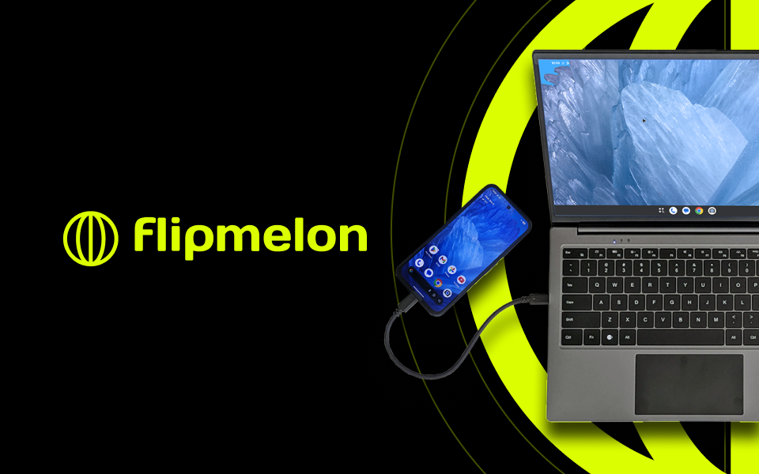

### Your Android phone. A bigger screen.

An open-source Windows companion for Android mirroring, powered by [scrcpy](https://github.com/Genymobile/scrcpy).

  

**[Portable Windows](https://github.com/santz1981/flipmelon/releases/download/v1.0.8.9-beta.1/Flipmelon_v1.0.8.9_Portable_Windows.zip)** · **[Release notes](https://github.com/santz1981/flipmelon/releases/tag/v1.0.8.9-beta.1)** · **[Português](docs/README.pt-BR.md)**

> **Beta:** v1.0.8.9-beta.1 is publicly available, but not yet considered stable. These Windows binaries are **not code-signed**. Do not disable Windows protections to run them.

## About Flipmelon

Flipmelon helps you connect an Android phone to Windows over USB, with a guided setup and [scrcpy](https://github.com/Genymobile/scrcpy) mirroring or a virtual display on supported devices. Built with Python and PySide6, it is an independent project — **not Samsung DeX for PC**.

## Features

- **Language first:** English is the default for new installations; select a language before any Android configuration.
- **Five UI languages:** English, Português, Русский, Español and Français.
- **Five-step wizard:** Android developer options, USB debugging, device authorization and display preferences.
- **Custom settings window:** Flipmelon-branded title bar for setup and configuration; the scrcpy mirror window remains native.
- **Display choices:** regular screen mirroring or a virtual Android display when supported.
- **Original Lottie splash:** the animation in assets/animations/logo.json runs via RLottie, not GIF, MP4 or Qt WebEngine.
- **Saved preferences:** local language and display settings.

## Download and install

| Download | Description |
| --- | --- |
| **[Windows Setup — Beta](https://github.com/santz1981/flipmelon/releases/download/v1.0.8.9-beta.1/Flipmelon_v1.0.8.9_Windows_Setup_COMPLETE.zip)** | Installer archive; contains an EXE plus two BIN files |
| **[Windows Portable — Beta](https://github.com/santz1981/flipmelon/releases/download/v1.0.8.9-beta.1/Flipmelon_v1.0.8.9_Portable_Windows.zip)** | No installation required |
| **[SHA-256 checksums](https://github.com/santz1981/flipmelon/releases/download/v1.0.8.9-beta.1/SHA256SUMS.txt)** | Verify downloaded packages |

**Requirements:** Windows 10/11 x64, an Android phone, a USB data cable and USB debugging enabled. Virtual display support varies by device.

### Install on Windows

1. Download the [Windows Setup ZIP](https://github.com/santz1981/flipmelon/releases/download/v1.0.8.9-beta.1/Flipmelon_v1.0.8.9_Windows_Setup_COMPLETE.zip) and **extract all files to the same folder**.
2. Keep the setup **EXE and both BIN files together**; do not run the EXE inside the ZIP.
3. Close any older Flipmelon and scrcpy processes.
4. Run **Flipmelon_Setup_v1.0.8.9_NoTemp_UNSIGNED.exe**.
5. Start Flipmelon, choose your language (English is the default) and follow the guided Android setup.

### Portable version

Extract the [Portable ZIP](https://github.com/santz1981/flipmelon/releases/download/v1.0.8.9-beta.1/Flipmelon_v1.0.8.9_Portable_Windows.zip), open the **Flipmelon** folder and run **Flipmelon.exe**. Keep the whole directory intact, including **_internal**.

**Security:** the binaries are unsigned and may trigger Windows security or reputation controls. Do not bypass protections. Report the exact warning via [GitHub Issues](https://github.com/santz1981/flipmelon/issues).

## Preview

  
  
Official splash artwork — not an application screenshot. Real setup and mirroring screenshots will be added after UI verification.

## Build from source

Windows 10/11 x64, Python 3.11+, PowerShell and internet access are required; Inno Setup 6 is optional.

1. Clone/download this repository.
2. Follow [Windows build instructions](docs/BUILD_WINDOWS.md) to download the checksum-verified scrcpy runtime using **scripts/get-scrcpy.ps1**.
3. Run **build-windows.bat**, then test **dist/Flipmelon/Flipmelon.exe**.
4. Find distribution files in **output/**.

Linux is not yet a verified release target. See [release checklist](docs/RELEASING.md).

## Status and roadmap

- **v1.0.8.8:** last Windows version reported working by the maintainer, including the RLottie splash.
- **v1.0.8.9-beta.1:** published beta with custom configuration window controls and language-first onboarding. Clean-install and functional verification is still required before stable release.
- **Next:** verify the beta, add real UI screenshots, improve accessibility and repeatable builds.

See [CHANGELOG.md](CHANGELOG.md) and [all releases](https://github.com/santz1981/flipmelon/releases).

## Contributing

Contributions, translations and bug reports are welcome. Read [CONTRIBUTING.md](CONTRIBUTING.md), check [Issues](https://github.com/santz1981/flipmelon/issues), or see [SECURITY.md](SECURITY.md).

## License and acknowledgements

The original Flipmelon source code is published under the [MIT License](LICENSE). The [branding policy](BRANDING.md) is a separate proposal awaiting final owner review. Third-party software has its own license and redistribution requirements; read [THIRD_PARTY_NOTICES.md](THIRD_PARTY_NOTICES.md).

Flipmelon is independent and is not affiliated with or endorsed by Samsung, Google, Genymobile or Qt.
