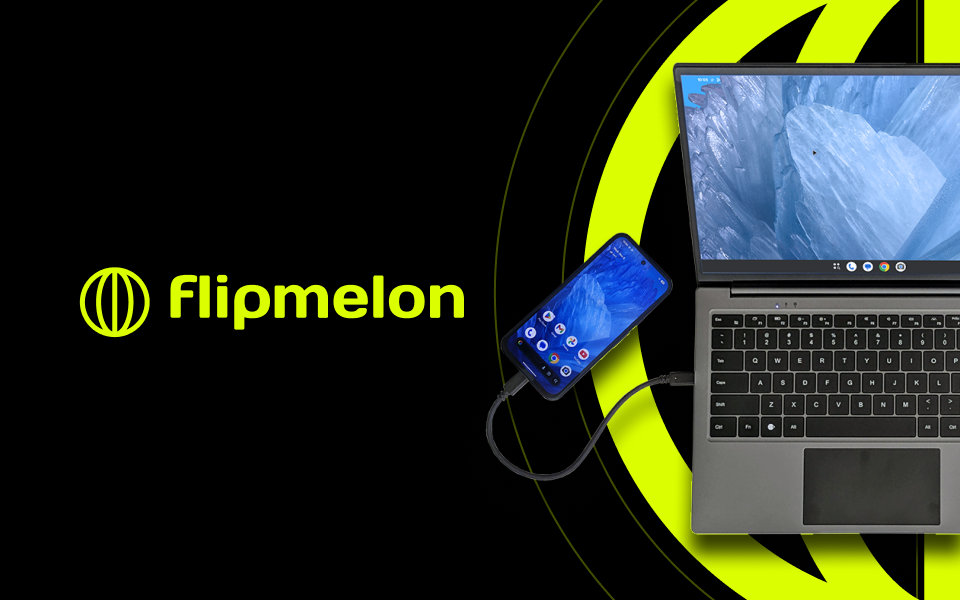

### Seu Android em uma tela maior.

Aplicativo open source para Windows, com espelhamento Android por meio do [scrcpy](https://github.com/Genymobile/scrcpy).

  

**[Windows portátil](https://github.com/santz1981/flipmelon/releases/download/v1.0.8.9-beta.1/Flipmelon_v1.0.8.9_Portable_Windows.zip)** · **[Notas da versão](https://github.com/santz1981/flipmelon/releases/tag/v1.0.8.9-beta.1)** · **[English](../README.md)**

> **Beta:** a v1.0.8.9-beta.1 está publicada, mas ainda não é considerada estável. Os executáveis **não têm assinatura digital**. Não desative as proteções do Windows para executá-los.

## O que é o Flipmelon?

O Flipmelon facilita a conexão USB de um celular Android a um computador Windows, por meio de um assistente e do [scrcpy](https://github.com/Genymobile/scrcpy), para espelhamento convencional ou tela Android virtual em aparelhos compatíveis. Foi desenvolvido em Python e PySide6. É um aplicativo independente, **não é o Samsung DeX para PC**.

## Recursos

- **Idioma primeiro:** inglês é o padrão para novas instalações, mas o usuário escolhe o idioma antes da configuração do Android.
- **Cinco idiomas:** English, Português, Русский, Español e Français.
- **Assistente de cinco etapas:** opções do desenvolvedor, depuração USB, autorização do aparelho e preferências de exibição.
- **Janela personalizada:** barra superior própria nas telas de passo a passo, painel e configurações; a janela do scrcpy continua nativa.
- **Modos de exibição:** espelhamento convencional ou tela virtual, conforme suporte do Android.
- **Animação Lottie original:** reproduzida com RLottie, sem GIF, MP4 ou Qt WebEngine.
- **Preferências salvas:** idioma e configurações de exibição armazenados localmente.

## Download e instalação

| Arquivo | Para que serve |
| --- | --- |
| **[Instalador Windows (Beta)](https://github.com/santz1981/flipmelon/releases/download/v1.0.8.9-beta.1/Flipmelon_v1.0.8.9_Windows_Setup_COMPLETE.zip)** | ZIP com instalador EXE e dois arquivos BIN |
| **[Windows portátil (Beta)](https://github.com/santz1981/flipmelon/releases/download/v1.0.8.9-beta.1/Flipmelon_v1.0.8.9_Portable_Windows.zip)** | Executar sem instalação |
| **[Verificação SHA-256](https://github.com/santz1981/flipmelon/releases/download/v1.0.8.9-beta.1/SHA256SUMS.txt)** | Conferir integridade dos downloads |

**Requisitos:** Windows 10/11 x64, celular Android, cabo USB de dados e depuração USB habilitada. A tela virtual depende da compatibilidade do aparelho.

### Como instalar no Windows

1. Baixe o [ZIP do instalador](https://github.com/santz1981/flipmelon/releases/download/v1.0.8.9-beta.1/Flipmelon_v1.0.8.9_Windows_Setup_COMPLETE.zip) e **extraia todos os arquivos para a mesma pasta**.
2. Mantenha o instalador **EXE junto dos dois arquivos BIN**; não execute o EXE dentro do ZIP.
3. Feche versões anteriores do Flipmelon e do scrcpy.
4. Execute **Flipmelon_Setup_v1.0.8.9_NoTemp_UNSIGNED.exe**.
5. Abra o Flipmelon, escolha o idioma (inglês por padrão) e siga o passo a passo.

### Versão portátil

Extraia o [ZIP portátil](https://github.com/santz1981/flipmelon/releases/download/v1.0.8.9-beta.1/Flipmelon_v1.0.8.9_Portable_Windows.zip), abra a pasta **Flipmelon** e execute **Flipmelon.exe**. Mantenha todos os arquivos, incluindo a pasta **_internal**.

**Segurança:** como o aplicativo não está assinado digitalmente, o Windows pode exibir avisos ou bloquear sua execução. Não desative as proteções. Relate os detalhes em [Issues](https://github.com/santz1981/flipmelon/issues).

## Prévia visual

  
  
Arte oficial da splash — não é um screenshot da aplicação. Capturas reais da interface e do espelhamento serão adicionadas após validação visual.

## Compilar a partir do código-fonte

Requisitos: Windows 10/11 x64, Python 3.11+, PowerShell, internet e Inno Setup 6 (opcional).

1. Clone ou baixe este repositório.
2. Siga o [guia de compilação Windows](BUILD_WINDOWS.md) para baixar o scrcpy oficial com verificação SHA-256 pelo script **scripts/get-scrcpy.ps1**.
3. Execute **build-windows.bat**.
4. Teste **dist/Flipmelon/Flipmelon.exe** antes de distribuir.
5. Os pacotes ficam em **output/**.

Linux ainda não possui um build de lançamento validado. Consulte o [checklist de publicação](RELEASING.md).

## Status e próximos passos

- **v1.0.8.8:** última versão reportada como funcional no Windows pelo mantenedor, incluindo a splash RLottie.
- **v1.0.8.9-beta.1:** beta pública com barra da janela personalizada e seleção de idioma antes do onboarding. Ainda requer verificação final de instalação limpa e funcionalidades antes de ser classificada como estável.
- **Próximas melhorias:** validar a beta, incluir capturas reais, aperfeiçoar acessibilidade e padronizar a compilação.

Consulte [CHANGELOG.md](../CHANGELOG.md) e [todas as Releases](https://github.com/santz1981/flipmelon/releases).

## Contribuições

Relatos de bugs, traduções e melhorias são bem-vindos. Leia [CONTRIBUTING.md](../CONTRIBUTING.md), consulte as [Issues](https://github.com/santz1981/flipmelon/issues) e [SECURITY.md](../SECURITY.md).

## Licença e créditos

O código-fonte original do Flipmelon está publicado sob a [licença MIT](../LICENSE). O uso da marca e das artes é tratado separadamente em [BRANDING.md](../BRANDING.md), cuja proposta ainda precisa de aprovação final do responsável. Bibliotecas e componentes externos mantêm suas licenças e obrigações de redistribuição: veja [THIRD_PARTY_NOTICES.md](../THIRD_PARTY_NOTICES.md).

O Flipmelon é independente e não possui vínculo nem endosso de Samsung, Google, Genymobile ou Qt.
